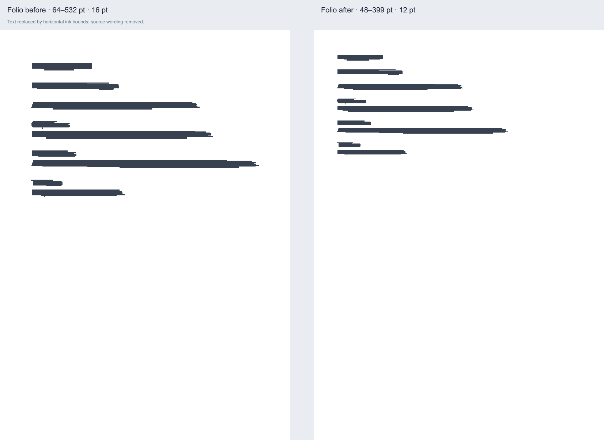

# Folio Conversion Fidelity Audit

**Date:** 2026-10-13; **Branch:** `fix/conversion-fidelity`
**Scope:** The 19 public browser-local tools, with implementation changes focused on Apple iWork PDF output. No deployment or merge was performed.

## A. Root cause analysis

### Pages horizontal displacement and clipping

The horizontal shift is in Folio’s iWork-to-PDF geometry adapter, not in the browser viewport, CSS layout, or `html2canvas`. The pinned `@file-viewer/renderer-iwork` 3.0.3 parser emits a generated Pages text-flow block at x=64, width=666 and font size 16, in CSS pixels, while assigning the page physical A4 dimensions as 595.28 × 841.89 PDF points. Folio previously passed those block values directly to `pdf-lib` as points. That placed the left edge 64 pt instead of 48 pt, made the text 16 pt instead of 12 pt, and declared a 666 pt frame on a 595.28 pt page. The frame extended past the page and long content could be cropped. The upstream parser source is [parser.ts at v3.0.3](https://github.com/flyfish-dev/file-viewer/blob/v3.0.3/packages/renderers/iwork/src/parser.ts); the conversion model is defined in [iwork.ts at v3.0.3](https://github.com/flyfish-dev/file-viewer/blob/v3.0.3/packages/renderers/iwork/src/iwork.ts).

The adapter now converts only the recognized generated Pages A4 flow-block signature with 72/96 points per CSS pixel. It scales the x/y position, width, font and spacing fields, and gives that generated flow text the remaining page-body height because the parser’s character-count estimate does not account for paragraph breaks. It does not apply this conversion to native object geometry or unrelated iWork text blocks.

For the available real modern Pages IWA sample, PDF.js extraction measured the previous Folio PDF at x=64 pt, font=16 pt and rightmost text x=532.08 pt; after the fix it measured x=48 pt, font=12 pt and rightmost text x=399.06 pt. The page remains A4 (595.28 × 841.89 pt), and all 240 extracted characters remain present. This demonstrates corrected placement and scale for that sample; it is not a comparison against a Pages-native PDF.

Other supported Apple objects now have page-bound checks. Rotated objects use their rotated bounding box. Text that would leave the page or its supported text frame, table cells that cannot fit, unsafe dimensions, and tables beyond the row/column safety limits fail with an explicit error instead of producing a silently clipped or partial PDF. Table lines are no longer truncated to four lines. Oversized page dimensions are rejected rather than clamped. Wide Numbers tables use landscape geometry based on the actual rendered chart height and page orientation.

### Pages read failure

The owner’s exact failing document was not available in the workspace. The locally available modern Pages IWA demo file was inspected and converted successfully through the browser UI after the geometry change: the parser identified an IWA-based `iwork-2013-plus` document with `limitedPreview=false`, and Folio produced a valid one-page A4 PDF containing 240 extracted text characters. Its package metadata reports `fileFormatVersion=26.4.0`; that value is not asserted to be the installed Pages app version. The local source file was not copied into this repository.

This evidence shows that the current parser can read and export this real modern sample. It does not identify the failure stage in the owner’s separate document, and that specific report cannot be marked reproduced or fixed without the exact file. Legacy package variations, damaged or encrypted containers, limited previews, and unsupported objects remain possible. Folio rejects parser limited previews and incomplete/unsupported-content diagnostics rather than claiming a complete export. The configured iWork parser is `@file-viewer/renderer-iwork` 3.0.3; Folio applies bounded archive/object/image limits and terminates its parser worker on completion, error, or timeout.

### Shared conversion architecture

The observed shift came from the Apple PDF adapter in `lib/iwork.ts`. DOCX→PDF uses a separate browser DOM/canvas path; PDF operations use `lib/pdfOps.ts`. The E2E matrix exercised those paths at multiple viewport widths without reproducing the Pages coordinate shift. This pass did not change shared HTML-to-PDF logic because the evidence isolated the defect to the generated Pages flow-block coordinate boundary.

## B. Public conversion matrix

The browser E2E run covered all public routes in Chromium, Firefox and WebKit. “Visual” below distinguishes measured layout assertions from native-application visual reference comparison. No Apple Pages, Keynote, Numbers, Microsoft Word, Excel, or LibreOffice application was installed for generating independent reference exports on this host. Existing historical native-app validation is documented separately in `docs/IWORK_NATIVE_OUTPUT_VALIDATION.md`; it was not re-run here.

| Public tool | Input → output | Validation fixture and result | Visual fidelity / known limits |
| --- | --- | --- | --- |
| Merge PDF | PDF → PDF | Browser fixture; merged/reparsed PDF and page count checked; repeated input and order covered by E2E. | Page streams are copied; no independent pixel diff in this pass. |
| Sign PDF | PDF + drawn/typed/image signature → PDF | Browser workflow exports draw, type and image signatures; invalid-image recovery and mobile viewport covered. | Signature placement checked in UI/export workflow; not a certificate-based digital signature. |
| Split PDF | PDF → PDF | Browser fixture; extracted PDF structure and requested pages checked. | Page extraction preserves source page streams; no pixel diff. |
| Compress PDF | PDF → PDF | Browser fixture; output reparsed and page count checked. | Client-side optimization may barely reduce an already optimized file. |
| Rotate PDF | PDF → PDF | Browser fixture; output reparsed and rotated page count checked. | Rotation changes page orientation metadata without re-rendering page content. |
| PDF to JPG | PDF → JPG / ZIP | Two-page fixture; both JPGs downloaded, decoded and counted in the archive. | Pages are rasterized at 2×; large files may use substantial device memory. |
| Images to PDF | JPG/PNG → PDF | PNG fixture; output PDF opened and page count checked. | One image per A4 page, fitted without distortion. EXIF rotation and broad device-specific color fidelity were not separately compared. |
| Word to PDF | DOCX → PDF | DOCX fixture; output PDF reparsed; shared browser test confirms expected page. | No Word/LibreOffice reference on this host. Complex pagination, headers/footers, tracked changes, and advanced layout can differ. |
| Pages to Word | Pages → DOCX | Pages browser fixture; ZIP and `word/document.xml` inspected; expected text found. | Structural package check only; advanced Pages layout/objects may differ or fail closed. |
| PowerPoint to PDF | PPTX → PDF | Two-slide fixture; valid output PDF and two pages checked. | No PowerPoint reference rendering here; animations, video, OLE and unsupported graphics are not exported. |
| Keynote to PowerPoint | Keynote → PPTX | Keynote fixture; PPTX archive, presentation part, two slide parts and expected text checked. | Existing historical native open/save check is recorded in `docs/IWORK_NATIVE_OUTPUT_VALIDATION.md`; not repeated on this host. Advanced Apple features are not exported. |
| Excel to PDF | XLSX → PDF | Multi-sheet browser fixture; PDF validity and page count checked. | No Excel/LibreOffice print reference here; formulas use saved values and advanced print styling/recalculation is not reproduced. |
| Markdown to PDF | MD → PDF | Multi-page Markdown E2E fixture; output validity, page count and text checked. | A4 browser rendering; raw HTML is disabled and remote images are omitted. |
| PDF to Markdown | PDF → MD | Text PDF fixture; extracted text/content checked. | Reconstructs text and defensible structure; scanned pages, complex columns, and original source Markdown are not recovered. |
| Combine documents | PDF/DOCX/MD/JPG/PNG → PDF | Mixed local fixture; ten-source bounded/order case and duplicate-PDF case covered; generated PDF reparsed. | Sources are normalized independently. DOCX/Markdown output remains renderer-dependent. |
| Pages to PDF | Pages → PDF | Synthetic parser-contract fixture plus one available real modern IWA Pages sample. Unit/E2E check A4 dimensions, x=48 pt, 12 pt type, text presence and right bound; viewport widths 390 and 1280 both pass in each browser. | The real sample has no trusted Pages-native reference; visual fidelity for native columns, headers/footers, fonts, images and complex layout remains unverified. Unsupported or incomplete output fails closed. |
| Keynote to PDF | Keynote → PDF | Keynote fixture in the all-tools/privacy E2E flows; PDF package/page assertions pass. | No native Keynote visual reference on this host. Animations, transitions, video and unsupported objects are not exported. |
| Numbers to XLSX | Numbers → XLSX | Numbers fixture; workbook structure, sheet/cell values and expected text validated in browser tests. | Saved values and table structure are exported; formulas are not recalculated and charts/formatting/native features may be omitted. |
| Numbers to PDF | Numbers → PDF | Numbers fixture plus unit tests for table pagination and wide-table landscape orientation; PDF dimensions/content inspected. | Tables and saved chart data use Folio layout, not Numbers native print styling; formulas are not recalculated. |

All 19 public tools loaded and completed their covered browser workflows in the full E2E matrix. This is not proof of universal file-format fidelity: fixture breadth and native reference availability differ by row. The actual app/browser compatibility verified in this pass is Chromium, Firefox and WebKit on this macOS host. Windows, iOS, Android, Edge, and physical Safari were not tested.

## C. Fixes applied

- `lib/iwork.ts`: maps the known generated Pages CSS-pixel flow geometry to PDF points; rejects unsafe dimensions; checks text, rotated objects, tables, images and shapes against page boundaries; removes silent four-line cell truncation; fails closed on oversized tables; validates scene/page count; and corrects wide Numbers table orientation/pagination geometry.
- `lib/iwork.test.ts`: adds focused regression checks for Pages coordinate conversion and PDF text bounds, overflow rejection, table text beyond four lines, oversized table rejection, landscape Numbers output, and invalid page dimensions.
- `e2e/web-browser-matrix.spec.mjs`: adds a Pages PDF geometry test at 390 px and 1280 px viewport widths. The test checks page dimensions, extracted text, left position, type size and right edge across all configured browser projects.
- `docs/audits/artifacts/pages-unit-fix-before-after.png`: redacted diagnostic comparing the previous Folio PDF output and the corrected Folio output from the available sample. The wording is removed; the image displays horizontal ink bounds and page scale only.

No dependencies, network conversion services, cloud upload paths, telemetry, or marketing files were added or changed. Document processing remains local to the browser.

## D. Before/after evidence

The artifact compares two Folio-generated outputs only. It is useful for seeing the scale/placement correction but is not an independent rendering of the source and is not a native Pages fidelity reference. The automated assertions independently check A4 page size and PDF.js text coordinates, rather than relying on this image as a golden screenshot.

## E. Remaining limitations and risks

- The owner-reported failing `.pages` file is absent, so its exact parser/read failure is unresolved and cannot be declared fixed. A later sample may use a damaged, encrypted, legacy, limited-preview or unsupported structure.
- No local native Pages/Keynote/Numbers or Word/LibreOffice references were available. Full visual fidelity of converted office/iWork documents is therefore unverified; the existing output remains a documented supported subset, not a native-layout replacement.
- Parser-generated Pages flow blocks matching the tested signature are handled. Other Pages object types retain their parser coordinate space and will fail closed if they exceed page/text bounds; fonts may be substituted; advanced layout, columns, headers/footers and unsupported objects are not guaranteed.
- Numbers exports use saved cell values; formulas are not recalculated. Keynote animation/timing/video is not represented. DOCX and spreadsheet PDF pagination can differ from native Office print engines.
- No dedicated large-real-Pages memory soak was run in this follow-up. Parser limits and worker termination are enforced; browser memory still depends on document size and device.
- Pixel/semantic comparison against native applications, Windows/iOS/Android testing, and a physical Safari run remain outstanding.
- `npm run lint` scans an untracked owner-owned vendored `marketing/launch-campaign/assets/gsap.min.js` and reports 199 minified-code lint errors. ESLint on the repository code excluding `marketing/**` passes. That file and its directory were left untouched and are not included in this change.

## F. Test results

| Check | Result |
| --- | --- |
| `npm run typecheck` | PASS |
| `npm test` | PASS — 156 tests across 17 files |
| `npm run e2e` | PASS — 141 tests in 6.9 minutes across Chromium, Firefox and WebKit; includes the new viewport-independent Pages geometry check |
| `npm run build` | PASS — Next.js 16.3.8 production build; 31 static pages generated |
| `npm run release:check` | PASS — browser release configuration complete |
| `npx eslint . --ignore-pattern 'marketing/**'` | PASS |
| `npm run lint` | BLOCKED by 199 lint errors in the untracked minified marketing asset; no errors reported in the scoped repository-code lint above |
| `cd apps/macos-helper && swift build` | PASS |
| `cd apps/macos-helper && swift test --scratch-path /tmp/folio-helper-tests-scratch` | PASS — 50 tests, 0 failures. A default in-repository test build hit iCloud resource-fork code-signing metadata; using a temporary scratch path passed without changing source. |
| `swift build --package-path apps/folio-mac` | PASS |
| `git diff --check` | PASS on the final staged changes. |

The one-off browser UI smoke on the available modern Pages sample produced a one-page A4 PDF and extracted all 240 source text characters. It is additional manual evidence, not a replacement for an owner-provided failing input or native-app comparison. The E2E privacy test passed; this work adds no outbound document requests.

## G. Release decision

**CONDITIONAL GO — for the tested, documented browser-local feature subset only.** The Pages geometry defect reproduced in Folio output from the available real modern sample is corrected and guarded by coordinate, bounds, and cross-browser viewport tests. The full current web E2E suite passes.

This is not a declaration that the owner-reported “cannot read” document is fixed. Before representing that issue as resolved, test the exact failing document and, where possible, compare its Folio output with an export from the Pages app that opens it. If the file still fails or supported content is clipped, keep Pages conversion release-blocked and revise the converter or support message. Do not claim native fidelity from the redacted Folio-to-Folio comparison.

No merge or production deployment was performed. The release-day report remains the source for hosting/account uncertainties; its Vercel dashboard checks were not authenticated, and this conversion audit does not change that status.
